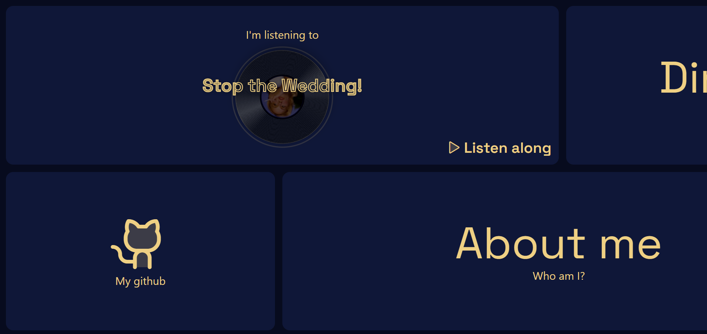
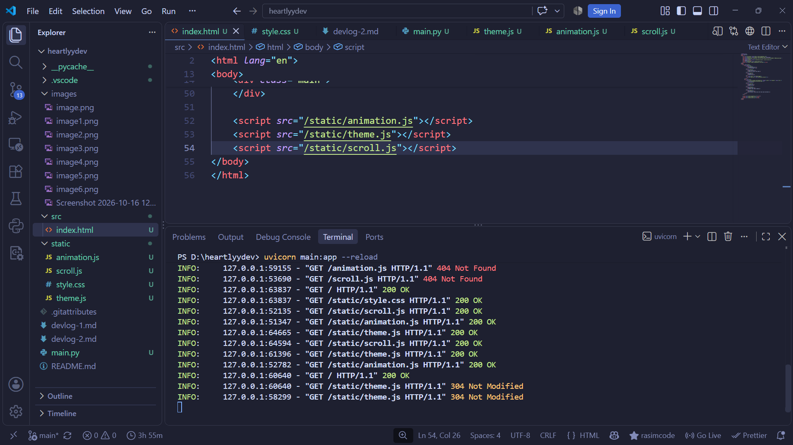

# heartlyy.dev

Heyy!! welcome to my corner of the internet.

Live at [heartlyy.dev](https://heartlyy.dev)

Sooo its built with FastAPI as backend. Html, css and native js for frontend. (with very cool animationsss and clean layout)

I write about how I made it in my [devlogs](https://heartlyy.dev/blogs/making%20of%20portfolio%20site) soo do check it outtt. And it has details if you wanna know *why* something is the way it is.



## What's inside?

* home: very cool layout with everything animated smoothly and mainly *scrolls* sideways (with momentum type scrolling). It stacks vertically on mobile tho :(. The animation speed changes depending on how fast your scrolll
* SPECIAL MENTION - NOW PLAYING: It's like a widget which shows if i'm playing any song at that moment (using last.fm's api) and allows preview that song using deezer (and ofcc with cool animationssss and can't forget the rolling disc loading animation)
* About me: it allows viewer to select how much time they have for looking at my shii and changes content according to it.
* projects: shelf of books, hover a book and it turns to show its cover. Which is like details about the project and screenshot(if it has), demo and code buttonss. Also *mainnn thing*, the project gets updated automatically with github's repo.. it checks for `heartlyy` tag in repo and if there is new repo with that tag, it adds the repo as project automatically
* blogs: devlogs and stuff in form of markdown which gets converted into html and also boards is just them in a folder
* gallery: random photos (I will upload once i go out somewhere) (will be like photo dump), and main thing.. the fonts used in this page are madee by meeee ;D
* Leave your mark: an infinite-ish canvass type thingy where visitors can leave a note. But the thing is: I added mail verification system so before visitors leave their note, they will have to approve their mail (note: i dont save them in plain form, they get hashed so mails can't repeat but at the same time, you keep your privacy). And the notes must also be approved by me (to avoid slurs and all)
* contact me: Old telephone dial themed and each hole represents some way to reaching me either my socails, my mail or even a direct msg system (it directly reaches my inbox)
* dino: a dino game (that i made) (but yahh is cooler than original with air jump and all) and it also works offline (using service worker)
* little extras: light/dark theme with a cool little circle animation, fly-in/fly-out page transitions, animatedd 404 page, embeds for discord/insta and all, `robots.txt`, `sitemap.xml`, `rss.xml` and manyy moree

## how to run it locally for yourself

```
git clone https://github.com/ProHeartly/heartlyydev
cd heartlyydev
python -m venv venv
source venv/bin/activate
pip install -r requirements.txt
```

make a `.env` file:
```env
ADMIN_MAIL =        # mail which receives codes, msgs and note requests
MAIL_PASS =         # password for that mail
SESSION_SECRET=     # long random jebrish
```

then run:

```
python main.py --dev
```

and open `http://127.0.0.1:8000/`.

*what is --dev?*
* codes get printed in the terminal instead of being mailed
* no github sync running in the background
* auto reload when you save

In production just run `python main.py`

(IF ANY ISSUE DO CONTACT ME)


## Writing a blog post

Put a `.md` file inside `content/blogs/<board>/`.
```
---
title: whatever
date: 2026-11-28
summary: one line which shows on the board page
---

# your post here

```

Use `YYYY-MM-DD` for the date

## Admin stufff
* admin login and note verification use 6 digit codes sent by mail (expires in 10 min, 5 attempt at max)