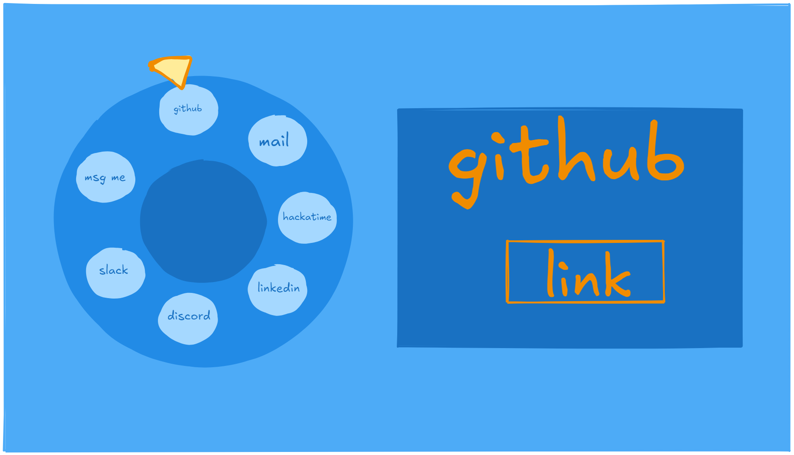
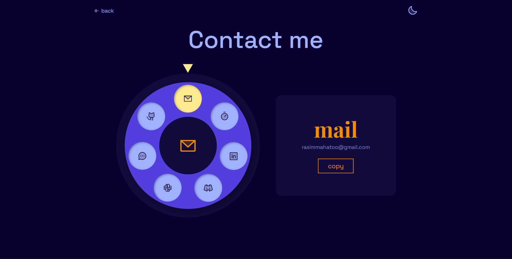

# Now it's time forrr contact me pageeee

This is also one of the really significant page. So I shall keep this really interesting and cool. It should have zero friction on dropping a msg to me.

SO my idea for now is a dial like that of old LANs, and each hole of numbers are icon of socials, mail, or msg me typa

**Idea and rough sketch**
The dial sits on the left, and every hole is one way to reach me like github, mail, linkedin, etc. There's a little point on top (like the metal finger stop), and whatever hole is under it, shows up big in a card on the right, with one button. That's it. Spin, see, click ;)

# Progress:
1) Making dial:
The best part is that dia lneeds no art at all, it's literally just circles:
* a big circle as the base
* a ring on top of it which is the spining part
* holes which are just round buttons
* a circle in the middle (with the selected thingy icon)
* and a little triangle pointer on top

The holes are placed around the ring using some maths; each hole gets an angle (360/ no of holes), and `cos` and `sin` turns that angle into left/top position. So if I add or remove a contact, the dial fixes itself.

**How the spinning works:** You can drag the ring, and the code checks the angle bettwen the triangle and the center of dial with `Math.atin2`, and rotates the ring by however much it changedd. When you let go, it spns into the nearest hole which always sits exactly under the pointer. You can also just tap on a hole and it spins itself to the top, or use the arrow keys from keyboard.

Bugs I ran into:
* tapping a hole did NOTHING. Turns out when you grab the ring for dragging (`setPointerCapture`), the ring steals the click from the hole. So now it remembers which hole you pressed, and if you didn't drag, it spins that one to the top.
* the whole dial was black cuz I wrote `innerHtml` instead of `innerHTML` (silly mistake, IK!)

Some small things I made sure of:
- My email is glued together by JS (`["name", "gmail.com"].join("@")`) so bots scraping pages can't grab it easily.
- Light mode looked ewww (purple ring + dark blue holes + a yellow pointer you couldn't even see), so in light mode it's now a blue dial with white holes and an orange pointer.

