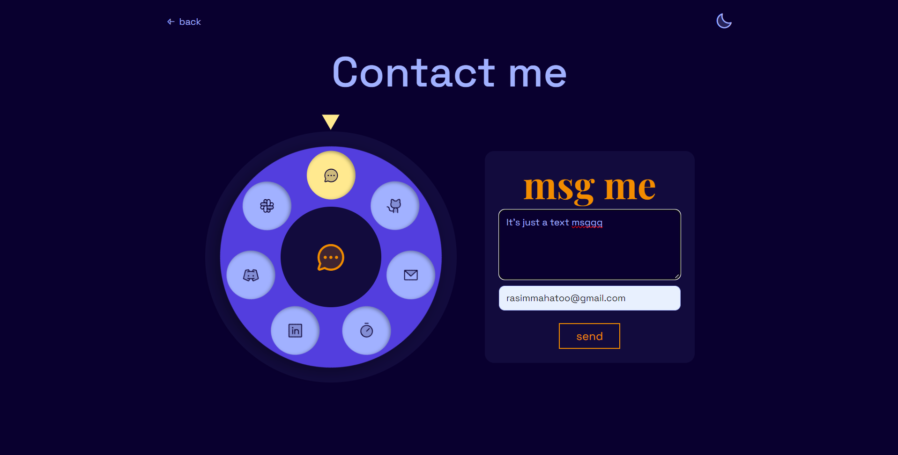
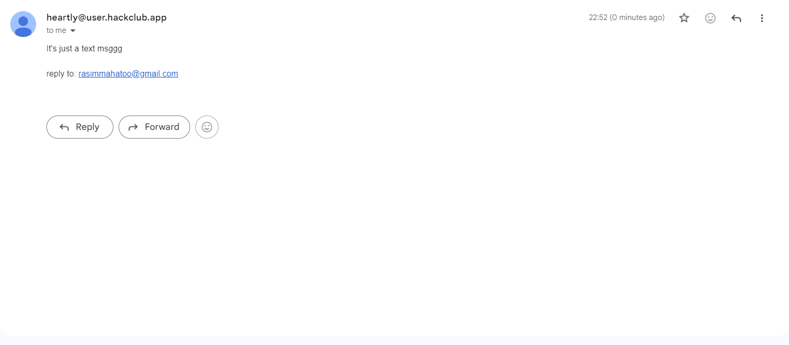

# Now it's time forrr contact me pageeee

This is also one of the really significant page. So I shall keep this really interesting and cool. It should have zero friction on dropping a msg to me.

SO my idea for now is a dial like that of old LANs, and each hole of numbers are icon of socials, mail, or msg me typa

**Idea and rough sketch**
The dial sits on the left, and every hole is one way to reach me like github, mail, linkedin, etc. There's a little point on top (like the metal finger stop), and whatever hole is under it, shows up big in a card on the right, with one button. That's it. Spin, see, click ;)

# Progress:
1) Making dial:
The best part is that dia lneeds no art at all, it's literally just circles:
* a big circle as the base
* a ring on top of it which is the spining part
* holes which are just round buttons
* a circle in the middle (with the selected thingy icon)
* and a little triangle pointer on top

The holes are placed around the ring using some maths; each hole gets an angle (360/ no of holes), and `cos` and `sin` turns that angle into left/top position. So if I add or remove a contact, the dial fixes itself.

**How the spinning works:** You can drag the ring, and the code checks the angle bettwen the triangle and the center of dial with `Math.atan2`, and rotates the ring by however much it changedd. When you let go, it spns into the nearest hole which always sits exactly under the pointer. You can also just tap on a hole and it spins itself to the top, or use the arrow keys from keyboard.

Bugs I ran into:
* tapping a hole did NOTHING. Turns out when you grab the ring for dragging (`setPointerCapture`), the ring steals the click from the hole. So now it remembers which hole you pressed, and if you didn't drag, it spins that one to the top.
* the whole dial was black cuz I wrote `innerHtml` instead of `innerHTML` (silly mistake, IK!)

Some small things I made sure of:
- My email is glued together by JS (`["name", "gmail.com"].join("@")`) so bots scraping pages can't grab it easily.
- Light mode looked ewww (purple ring + dark blue holes + a yellow pointer you couldn't even see), so in light mode it's now a blue dial with white holes and an orange pointer.

2) Msg me thingy:
This is kinda the optional part of the about me page. I mean it wouldn't really matter if I didnot include this but kinda is a good addition anyways so.

**How it works:**
* the box is in a `<template>`, which doesn't show up on the page. When you press write, JS copies it into the card.
* there's an optional "where do you expect a reply?" field. If you put your mail there, it becomes *Reply-To* of the mail, so I can give you a reply.
* `main.py` has `/contact` route which takes the msg and sends it to me using the hackclub mail which is very similar to gallery login code system.

**FIGHT WITH BOTS:** I think everyone knows, bots LOVE forms for spamming, so I added some sneaky protection (no annoying verification or anything):
* a hidden field which humans can't see but bots can and fills in. If gets filled, we assume its bot and don't send the msg.
* a too fast interation. The page can tell how long you were on it, and if the interaction lasted faster than 3 seconds, it counts as a bot.
* max 3 msg an hour per person, after that it says "too many, try later"

**Bugs I ran into:**
* nothing was sending, it always said "didn't send, try again". Turns out my textarea was `name=message` but the route was sending `msg`, so the server always got an empty msgg. (this was a simple fix)

3) ONE QOL update(VERY IMPORTANT QOL update):
While asking my friends to test the dino game, I realised that dino's game speed really depended on the refresh rate of the device, it ran perfect for me so I thought would for everyone else, but turns out my friend were experiencing 2x my speed so they complained about the game being very hard.

**How i fixed it:** Now every frame checks how much time actually passed since the last one (`requestAnimationFrame` already gives us the time for free). I call it `dt`, and I count it in "60fps frames"

Then I multiply everything by `dt`

Some small things I made sure of:
- `dt` is capped at 3 (`Math.min(3, ...)`). Other wise when you switch tabs and come back, one frame would have a HUGE `dt` and the cactus would teleport straight into the dino.
- The air jump cooldown uses `Math.max(0, cd - dt)`. Since `dt` has decimals, the cooldown could go a tiny bit below 0, and then the air jump would never come back lol
- Jumping itself doesn't use `dt`, because it happens once when you press, not every frame.