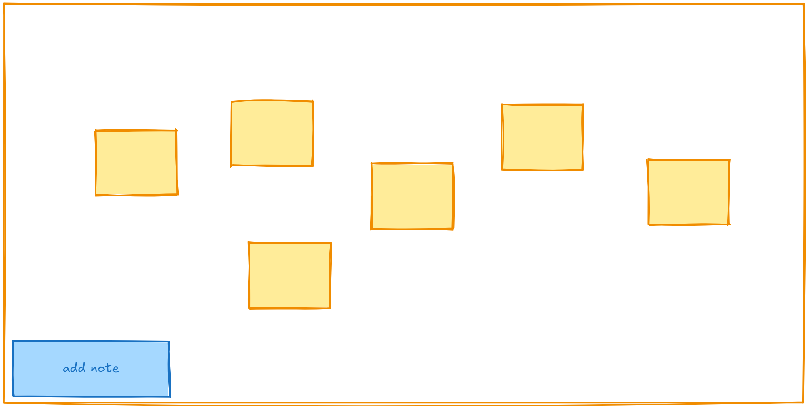
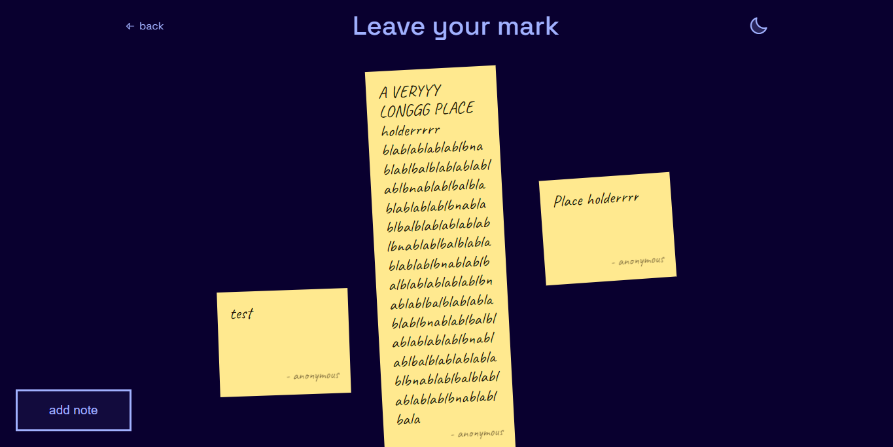

# Making leave your mark page.

This will be a fun little page where people can leave their note on the page, maybe something like "heartly was here" which was one of the way people used to leave their marks especially on minecraft and I also did it alottt. But I will give them freedom to write anything except of racial slurs, nsfw and stuff like that.

although, this is veryy fun part but also creates security concerns reguarding spam, slurs, and might even attract bad actors. So, one fix which I can think of is: using mail verification system, bascially using email servicem, which we already, have to send code to verify their mail and only letter a single note per mail! And a review system, which is basically, me choosing to show or hide it. (I vow to show even bad review and just hide/delete bad stuff)

**Design of page**
So this is the design that I'm thinking of: a canvas with all the notes, a add note button and in top our usual stuff

# Progress:
1) Changing the exisiting `send_code` function to send the mail:

Originally, it could only send mail to `ADMIN_MAIL` but now i added a new argument: `to` which is the mail which we want to send mail to. And I also changed the language of mail which seemed abit off.

2) Making POC:
Before doing any of the mail and review stuff, I wanted to see how the notes actually look and feel on the canvas, so I made a POC with some static texts first.

**Infinite canvas:** It's not acutally infinite lolll, it's just a trick! All the notes sit inside one big `.world` div, and when you drag (or scroll), I just move that whole div with `translate`. So it feels like you're moving around a board. The dot grid in the background moves wit hit too `background-position`, so it all feels like one big board.

**Notes:** Each note is a little yellow sticky, with handwritten font (Caveat) (I might make a new one later), with a `- name` at the bottom. Each one is tilted a tiny bit using `(i * 37 % 9) -4` degrees, so they look like hand stuck instead of perfectly straight.

***No overlapping~***  This was the fun part. Before placing a note, I measure its real size first (long notes are taller), then check if that spot is free, if it's not, it goes round the spot in bigger and bigger circle till it finds a free one.

3) Making the flow:

**Important note:** I forgot to mention but one thing that I deeply thought of was, hashing the mail of the user (I really don't want the visitors feel uncomfortable for letting me have their mail, I WILL be hasing their mails when storing! so like same mails can't post twice while not storing it too.)