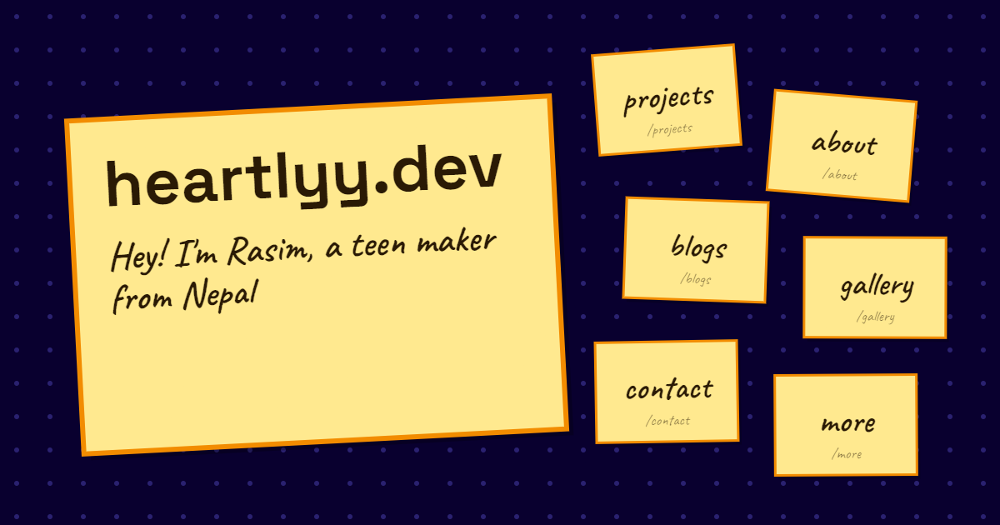
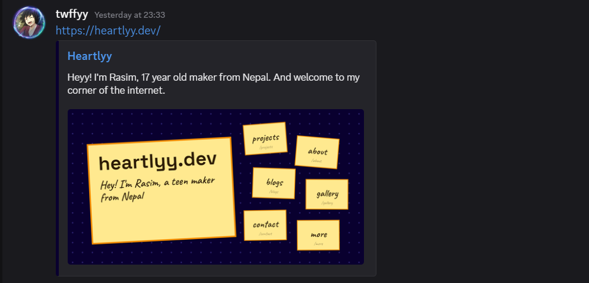
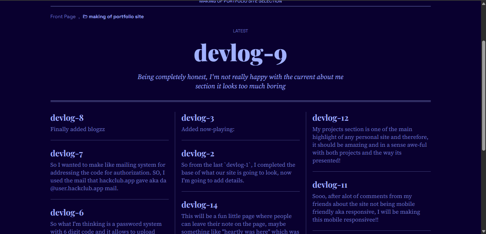
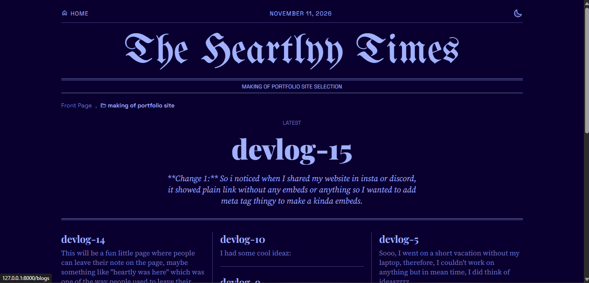
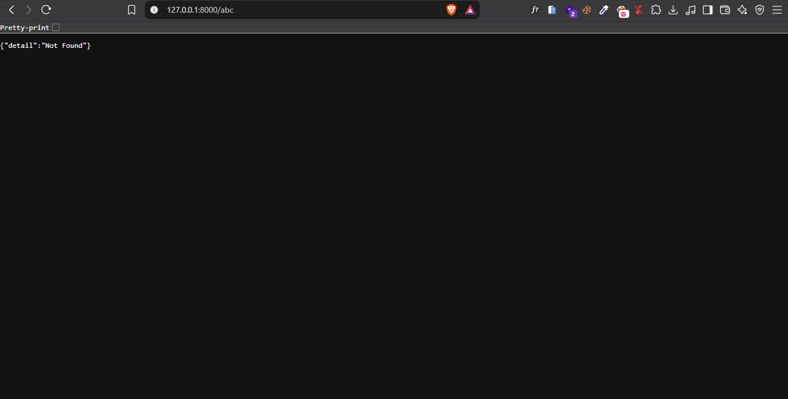
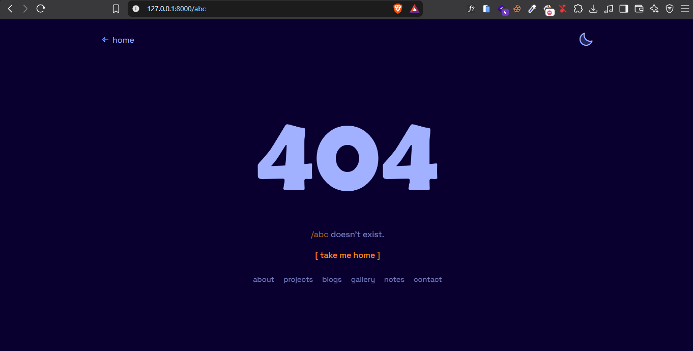
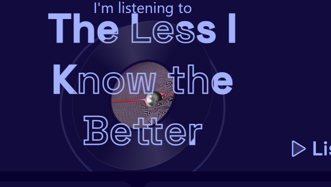

# Qol updates

**Change 1:** So i noticed when I shared my website in insta or discord, it showed plain link without any embeds or anything so I wanted to add meta tag thingy to make a kinda embeds.

what we can do:
* `title` and `description`: this shows in the tab and in google search result.
* `og:` tags (oepn graph): this is shown by discord, whatsapp, slack, and other platforms to make preview card aka embeds, lie title, description, and a image.
* `twitter:card`: tells x to show the big image version.
* there are others too but those are mostly not needed.

I made a `meta.html` which has all the meta things and every other page just uses
```html



```
So every page has its own title and description, but the tags are written only once at `meta.html` And for the blog posts, it uses post's own title and summary, so every devlog gets its own preview thingy.

I made a image which will show in each page with what my site contains


Small things that i made sure of:
* my blog boards have spaces in their names, so the page link goes through `urlencode`, which if not present can make link in the tag broken
* added `canonical` so google knows the real address of each page



**Change 2:** I added favicon, I designed a favicon in affinity which is basically a heart and a little sparkle


It's exported in 3 sizes: `favicon.svg` (basically svg format), `favicon.png` (32x32 for old type browsers) and `apple-touch-icon.png` (180px for when you add to phone's home screen, just in case :D)

**Change 3:** Basically in blog boards page, the post name was being compared as text rather than number which made `devlog-9` be latest even when `devlog-15` was present, it was due to it comparing them as text



**Change 4:** Originally, when someone visited a directory which doesn't exists, this showed up



but lets change it to something cool, shall we???
So I made an animated page, basically its animated like the zero acts as a eye which closes from time to time


uhmm, you can look at the frames but idk how to show it thru images


**How it works:**
* all 4 frams are drawn side by side in one png (a sprite sheet), so the browser only loads one image a time
* the png is used as a mask, which means only its shape matters, not its colour. The color comes from `--text-color`, so its theme changable
* a css animation jumps between the 4 frames with `step-end`, so it snaps from frame to frame instead of sliding
* and if someone turned off animations in their settings, it just stays still

**Change 5:** Making the homepage animation catch up when scrolling goes zooommmm(not zoom, like very fastt)

I'm a big fan of my own creation, the homepage animation but the problem is it slowly slides for like 2 seconds and it might be still half way in, if you scroll very fast. I do like it being 2 seconds, i dont wana reduce it, sooo a new approach which I could think of was...

Now animation speed changes depending on how fast YOU are scrolling

**How it works:**
* everytime the page scrolls, `animation.js` checks how far it moved, and how much time passed, which gives the scroll speed (in pixels per millisecond)
* it smooths that speed a bit (`speed * 0.6 + v * 0.4`) so one jumpy frame doesn't counts
* if you stopped scrolling for 150ms, it counts as not crolling at all
* when a card comes into view, it gets a `--pace` from that speed: where 1 means the full slow animation, smaller means faster animation sleepd but it never goes below `0.3`(about 3 times quicker)
* in the css, every duration is just multiplied by it, like `calc(2s * var(--pace, 1))`, and the delay between cards too

I tuned it with `fast * 0.2`, so it only speeds up for real flicks, normal scrolling still gets almost the full satisfying animation.

**Change 6:** Fixing `scroll.js`

Soo I found few problems with our current `scroll.js`, it's not that it doesn't work but the issue lies in what it is preventing.
* zooming doesn't work: it uses `preventDefault()` to take over the mouse wheel, which also blocked ctrl + scroll zoom, and even pinch to zoom features
* swiping sideways on a trackingpad did nothing, its cuz originally it only relied on `deltaY` and ignored `deltaX` which is the side ways scrolling.

SO to fix this, first of all, i made a escape case for when `ctrl` key is pressed and lets browsers zoom, and other thing is I added `const delta = Math.abs(e.deltaX) > Math.abs(e.deltaY) ? e.deltaX : e.deltaY;` this statement to calculate the `delta` instead of fully relying on `deltaY`

**Change 7:** Added momentum scrolling to other pages as well!

Soo the home page had momentum scroll which is also often called acceleration scroll, which is basically, the scrolling works like it has momentum and doesn't stop the exact moment that we stop scrolling, and scrolls for a little bit longer, which is just so coolll so we will be making that in our site on other pages too which doesn't have custom scroll animation. Its kinda same logic as our original scrolling

Now what i did is: change `scroll.js` to `side_scroll.js` and this is for `index.html`
and made `scroll.js` for other pages which has normal scrolling behaviour

**Small things that I really made sure of:**
* ctrl + scroll still works, same as change 6.
* trackpads already have their own smooth scrolling, so adding mine on top made it feel floaty. Now small trackpad movement are left alone. (returned)


**change 8:**
So I found one issue with now-playing thingyyy.. in small screens, the text gets clamped and THE main issue was the record thingy which was supposed to be circle becomes oval..


to this


I first of all, made the text size: `font-size: clamp(2.4rem, min(6vw, 10vh), 4rem);` which makes the text more fitting and for records i changed how it had fixed height and width, to being `height: min(250px, 65%);` and aspect ratio: `aspect-ratio: 1;` which means the width is auto adjusted to be same as height.

**Change 9:** One random idea which I had was making a little different loading animation for playing-now.

So the animation goes like:
* the card slides in same way like others
* then the record rolls from the left, like a wheel and ngl it kinda looked cleann
* "I'm listening to" text drops into its place
* the song name wipes in from left to right, first the filled text then the outline thingy gets filled
* lastly, the listen button rises

 **Change 10:** What I noticed was, jummping from one page to another was little unpleasent like i felt something was missing.. so I thought of animating that too.

Testing with different animations, some like expanding the card seemed kinda good animation at first but different pages had different `--card-bg` value so it seemed glitchy. Another animation which I tried was fade-in fade-out animation which is classy but didn't stand out too much for me. So I ended up going with something like cover up animation from ppt ;).

This has two varients:
* jumping from index to other page goes as cover up from right to left.
* going back to index goes as the cover moving to left to reveal the home page behind.

So in technical words:
In `transitions.js`, `e.viewTransition.types.add("from-home");` this statement is used to add a transition type name, and when going to other pages from home, its used to denote, we are comming from home and hence, the css in `transitions.css`, `html:active-view-transition-type(from-home)::view-transition-new(root)` this element is the comming one and we add animation to this