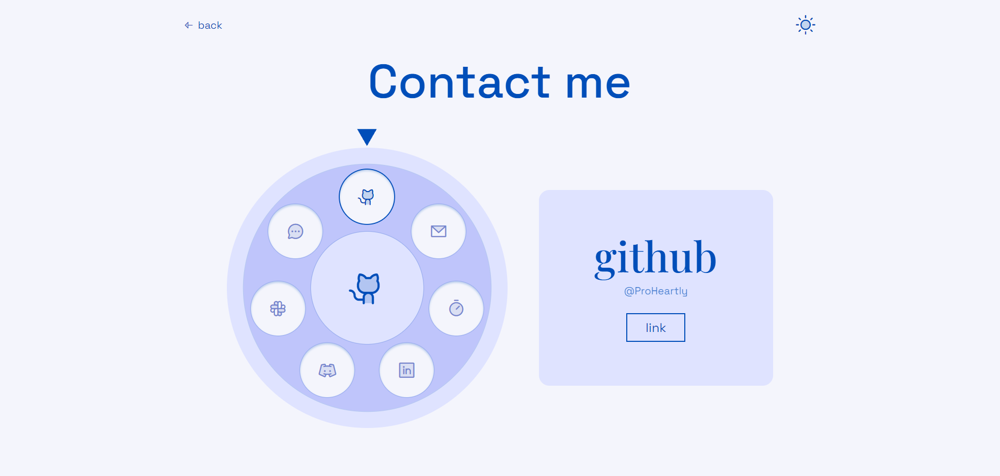

# Revisiting contact me

While making, the contact page kinda seemed good to me but now it seems too much cartoonish maybe it was the amount of effort, it took which made it look okish at the time i finished it but now it kinda looks off..

My first instinct is that the color pallet is kinda off.. so lets get fixing

1) The color fixing: I changed the colors from being brightish and feeling like its out of our original color pallet to smth that feels like they are from our original color pallet. I was right.. the cartoon feel comes from the added colors: a bright purple ring, solid perwinkle holes, yellow pointer and orange accent. This made the page feel cartoonish!

so I changed the pallet to
```css
:root, [data-theme="dark"] {
    --bg-color: #09002f;
    --card-bg: #120b3d;
    --text-color: #a1b1ff;
    --ring: #1a1250;
    --hole: #0b0436;
    --hole-ink: #5d68b0;
    --pointer: #a1b1ff;
    --accent: #a1b1ff;
    --shadow: rgba(0, 0, 0, 0.45);
}

[data-theme="light"] {
    --bg-color: #f4f5fc;
    --card-bg: #dfe3ff;
    --text-color: #004EB9;
    --ring: #bfc5fb;
    --hole: #f4f5fc;
    --hole-ink: #7486cf;
    --pointer: #004EB9;
    --accent: #004EB9;
    --shadow: rgba(0, 78, 185, 0.25);
}
```

and instead of `.hole.on` filling, i changed to giving it a thin ring insteadd.


2) Something felt little off: The ring had a big soft shadow and the holes had soft inner shadow so it looked little off so i added a new variable `--edge` for edge shadow and decreased the inner shadow.

