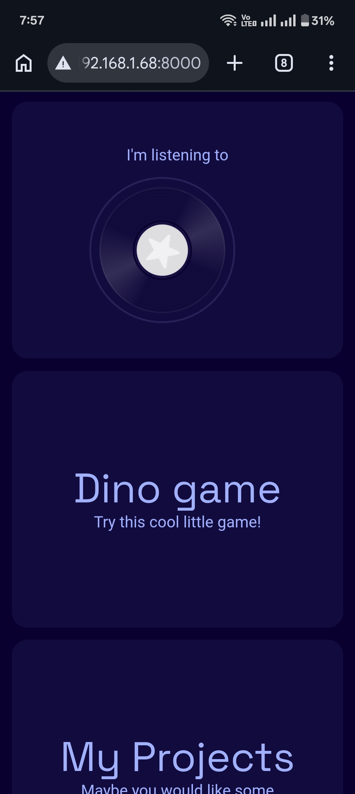

# Rework for mobile layout

**Current issue:** Sooo after collecting more feedbacksss, it turns outt the horizontal layout in mobile is very confusing when given without any instruction or mainly people assume, it's poorly designed or mobile responsive is not made.

**My plan:** Its really simple, let's make the layout vertical for mobile where the github and theme change card get placed together.. but idk how it will turn out! lets see

## Progress:
1) Making vertical layout:
First of all, making `overflow-y` visible and `overflow-x` hidden. Then making `height: auto;` and converting `.main` in to a `grid` with `grid-template-colums: 1fr 1fr;` which means we can stack two things in same column.

Using `grid-column: 1 / -1;` in other cards excluding github and theme change cards so they both stack together while other cards get their own column.

**Bugzz:** *(OFCC BUGZ)*
1) All elements were squeezed at first and the now playing element wasn't even loading, which I fixed with `min-height`



2) As you can see in the ss above, the order of cards is very messed up (I mean feels like they were placed at random), which goes like song, dino game, my projects, blogs, theme and github, about me, my gallery, leave your mark and at last contact me. Let's change this into something like song, about me, my projects, blogs, theme and github, gallery, dino game, leave your mark and at last contact me.

We can do this by either changing html which also changes for overall viewers but i don't think I wanna do that sooo i will be using a css property called `order` which orders the elements.

**small fix:** also changed `min-height` to `40vh` which means 2 cards fits and one barely fits which kinda prompts user to scroll :D

3) Animationnnn timeee:
So previously animations where made in context of horizontal layout so now, we have to translate that animation to vertical layoutt

So it's basically left and right fly-in animations alternatingly placedd

```
.row .card.a:not(.in-view),
.row .card.b:not(.in-view),
.row .card.g:not(.in-view),
.row .card.j:not(.in-view) {
    opacity: 0;
    transform: translateX(-200px);
}

.row .card.d:not(.in-view),
.row .card.e:not(.in-view),
.row .card.i:not(.in-view),
.row .card.h:not(.in-view)
{
    opacity: 0;
    transform: translateX(200px);
}

.row .card.c:not(.in-view) {
    opacity: 0;
    transform: translateX(-100px);
}

.row .card.f:not(.in-view) {
    opacity: 0;
    transform: translateX(100px);
}
```

and there is a little different offset values for `.card.c` and `.card.f` cuz they are the two little cards of github and theme change, so if they are as far as other cards, they donnot cross the threshold of `animation.js` and never load, so i kept them just in the edge.

**small fixes:**
* the contact me page was getting glitched for some reason and i was trying random stuff, I still don't know what fixed it but when using `svh` as unit for `min-height` and using different settings of overflow eliminated it.
* I added different value of pace and delay in `animation.js`, for mobile, they `--delay` remains 0 and `--pace` remains `0.5`