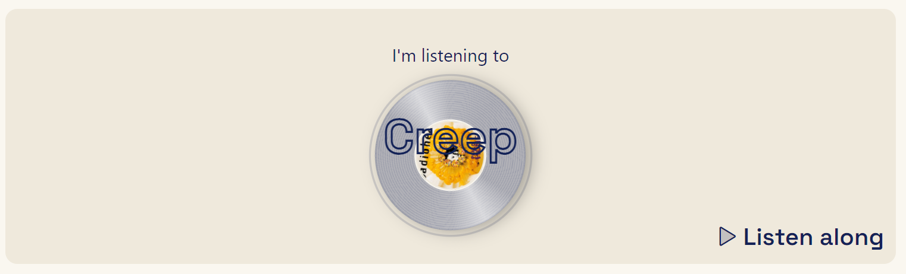
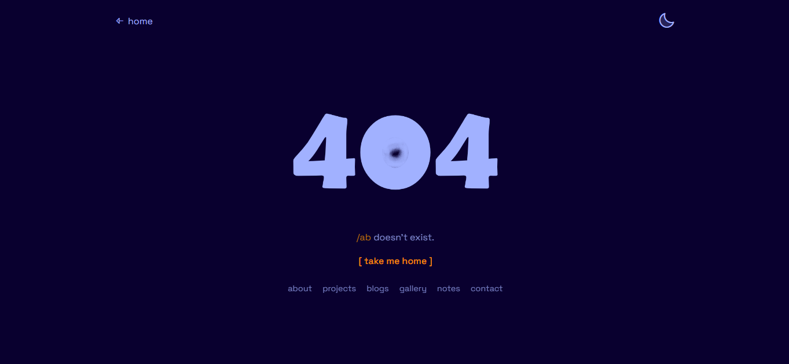
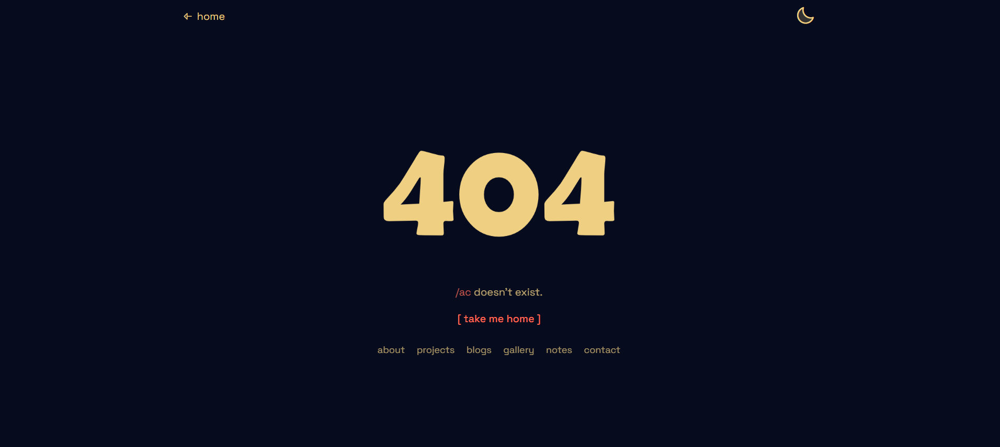

# changing the color pallet

1) Ermm sooo I wanted to experiment with more colors sooo I decided to test different colors.. like
```css
[data-theme="dark"] {
    --bg-color: #160924;
    --card-bg: #231036;
    --text-color: #b8f28a;
}

[data-theme="light"] {
    --bg-color: #f6faf2;
    --card-bg: #e5f0dc;
    --text-color: #4a156e;
}
```

This
```css
[data-theme="dark"] {
    --bg-color: #06161e;
    --card-bg: #0c232e;
    --text-color: #ffb482;
}

[data-theme="light"] {
    --bg-color: #fdf6f0;
    --card-bg: #f5e6d8;
    --text-color: #0b4f6c;
}
```

also this
```css
:root, [data-theme="dark"] {
    --bg-color: #120d0c;
    --card-bg: #1e1614;
    --text-color: #ffb09e;
}

[data-theme="light"] {
    --bg-color: #f8f5f0;
    --card-bg: #ede7de;
    --text-color: #c4361d;
}
```


and finally the one which I liked isss
```css
:root, [data-theme="dark"] {
    --bg-color: #090624;
    --card-bg: #13113b;
    --text-color: #f2d48d;
}

[data-theme="light"] {
    --bg-color: #f9f6f2;
    --card-bg: #ede7df;
    --text-color: #24195e;
}
```

This kinda gibes the premium and cool like vibess. Where the text pops up and kinda feels intentionalll designn

2) Changing vinyl from song card:

So the vinyl looks abit washed out sooo I decided to change it too.. and I started to play with value, with new styles and everything and at the end what worked was
```css
background:
    /* light reflectionnn */
    conic-gradient(
        from 25deg,
        transparent 0deg,
        rgba(255, 255, 255, 0.16) 28deg,
        rgba(255, 255, 255, 0.03) 55deg,
        transparent 95deg,
        transparent 180deg,
        rgba(255, 255, 255, 0.16) 208deg,
        rgba(255, 255, 255, 0.03) 235deg,
        transparent 275deg
    ),
    
    /* ring and other edgee */
    radial-gradient(
        circle,
        transparent 0% 24%,
        rgba(0, 0, 0, 0.35) 24.5% 33%,
        rgba(255, 255, 255, 0.07) 33.5%,
        transparent 34.5% 96%,
        rgba(0, 0, 0, 0.4) 97% 100% 
    ),
    
    /* grooves thingy (circles running out) */
    repeating-radial-gradient(
        circle,
        rgba(0, 0, 0, 0.28) 0px,
        rgba(0, 0, 0, 0.28) 1px,
        rgba(255, 255, 255, 0.04) 1px,
        rgba(255, 255, 255, 0.04) 3px
    ),

    /* vinyl basee */
    color-mix(in srgb, #080b14 82%, var(--card-bg));
```

and in addition to this, i added:
```css
border: 1px solid color-mix(in srgb, var(--text-color) 22%, transparent);
box-shadow: 0 8px 24px rgba(0, 0, 0, 0.32);
```
for box shadow and border... and noww it looks damn coolll


but the issue is the light mode, the text is not clear


3) Fixing the vinyl in light theme:

**first attempt:** using `-webkit-text-stroke: 2px var(--bg-color);` i tried making the outer text be the color of background


but this didn't give the vibe that i wanted so lets try another approachhh

**another attempt:** making a completely new design for light mode..

so with `[data-theme="light"]`, i can check if the theme is light mode and if it is, we change the
`.card.a .record` into new background like:
```css
[data-theme="light"] .card.a .record {
    background:
        /* light reflectionnn */
        conic-gradient(
            from 25deg,
            transparent 0deg,
            rgba(255, 255, 255, 0.55) 28deg,
            rgba(255, 255, 255, 0.12) 55deg,
            transparent 95deg,
            transparent 180deg,
            rgba(255, 255, 255, 0.55) 208deg,
            rgba(255, 255, 255, 0.12) 235deg,
            transparent 275deg
        ),
        
        /* ring and other edgee */
        radial-gradient(
            circle,
            transparent 0% 24%,
            rgba(19, 34, 87, 0.12) 24.5% 33%,
            transparent 34.5% 96%,
            rgba(19, 34, 87, 0.18) 97% 100% 
        ),
        
        /* grooves thingy (circles running out) */
        repeating-radial-gradient(
            circle,
            rgba(19, 34, 87, 0.12) 0px,
             rgba(19, 34, 87, 0.12) 1px,
            transparent 1px,
            transparent 3px
        ),

        /* vinyl basee */
        color-mix(in srgb, var(--card-bg) 72%, var(--text-color) 28%);
}
```

So here, i used lighter colors to connect with the theme :D



Now! i'm satisfied with how it looksss

**small change:** I changed the width of outline of `track-front` from `2px` to `3px` which is kinda small change but huge difference

4) Making each page follow the color pallet nowww!

**About me page:** for about me, i tried to keep the original style but at last went with style of
```css
:root, [data-theme="dark"] {
    --bg-color: #070b1e;
    --card-bg: #132257;
    --text-color: #efd083;
}

[data-theme="light"] {
    --bg-color: #faf7f0;
    --card-bg: #efd083;
    --text-color: #132257;
}
```

so here, the `card-bg` and `text-color` swaps on changing theme

**404 page:**



this is the original one, here the orange thingy gives viewer a place to focus on, so following same color pallet, i came up with this combo



**Contact page:**

I tried changing same amount of difference as original color pallet

```css
:root, [data-theme="dark"] {
    --bg-color: #070b1e;
    --card-bg: #0f1738;
    --text-color: #efd083;
    --ring: #131b42;
    --hole: #090e26;
    --hole-ink: #a09060;
    --pointer: #efd083;
    --accent: #efd083;
    --shadow: rgba(0, 0, 0, 0.6);
    --edge: rgba(239, 208, 131, 0.16);
}

[data-theme="light"] {
    --bg-color: #faf7f0;
    --card-bg: #efe9dc;
    --text-color: #132257;
    --ring: #e0d7c5;
    --hole: #faf7f0;
    --hole-ink: #7d86a8;
    --pointer: #132257;
    --accent: #132257;
    --shadow: rgba(19, 34, 87, 0.25);
    --edge: rgba(19, 34, 87, 0.18);
}
```

**another small change:** As i was in contact page, i noticed a thing which i was thinking of changing from a long time, the order of things like originally, github was the first thing that was on default but not i changed that to msg me so people can quickly contact mee

**Dino page:** It used same variables as main page so i just replaced values of them. *But* I didn't change the game colors cuz it looks good as it is.