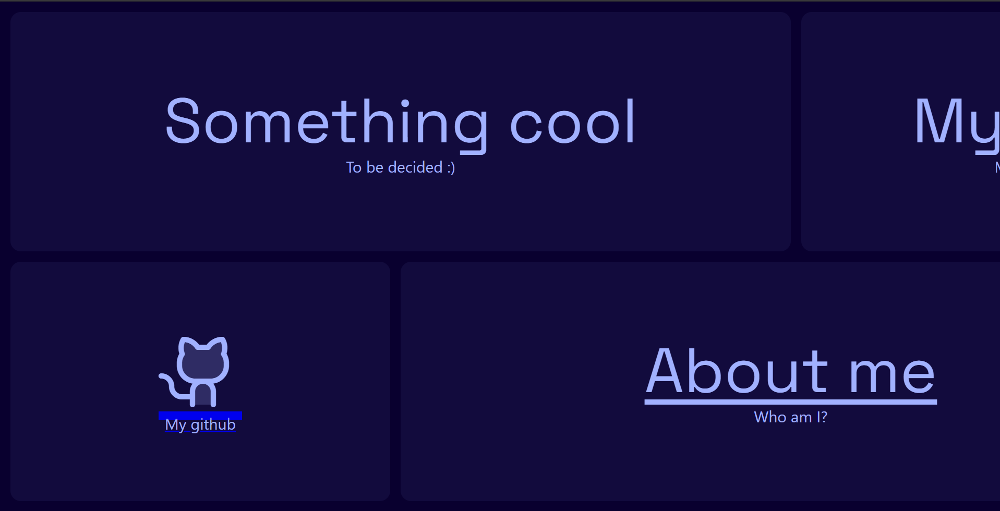
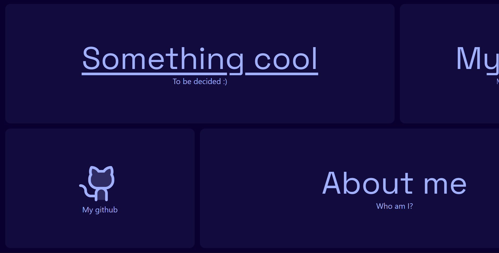
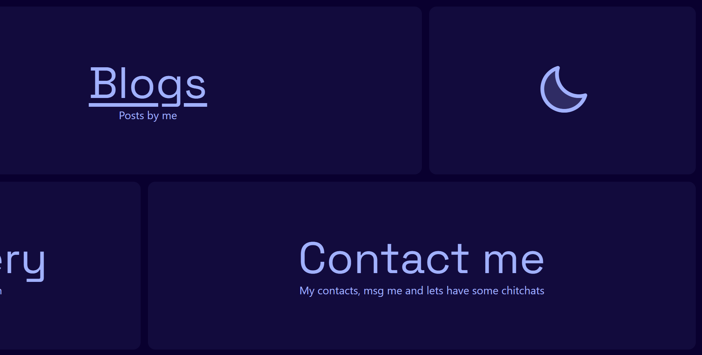
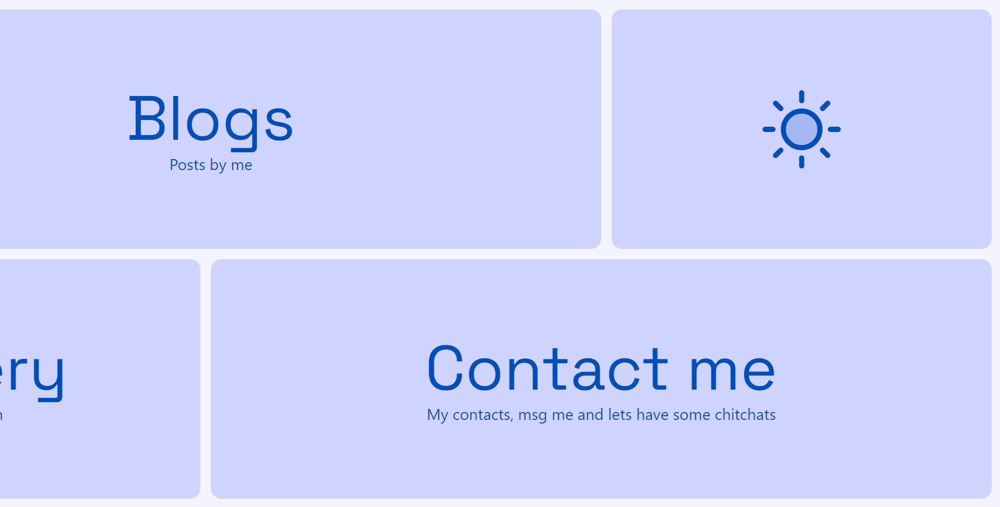
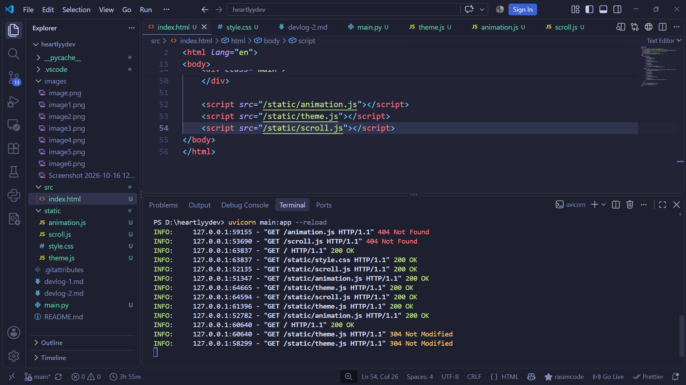

# Actually adding the details:

So from the last `devlog-1`, I completed the base of what our site is going to look, now I'm going to add details.

By details, I mean like what things will be in the site, i.e. my projects, about me, contant, etc etc. (I will definitely add some cool things too)

And I will layoff base of backend too

## Progress:
* ### Added details:
    before I talk about what I added, a little fix that I did:
    
    this is what happened when I add anchor tag instead of div, this way maybe due to `text-decoration` I thought but I had it in all of elements of `.card` class yet, it came. Then I found out, the simple fix is to add `text-decoration: none;` to `.card` itself!
    

    So I decided to put: github, about me, my projects, my gallery, blogs, contact me, changing theme button and a card which I don't know what I'm going to put but I will put something fun or interesting. (no idea for now)

* ### Added theme functionality:
    Now, the site has two themes; dark and light  
    **dark:**
    
    **light:**
    

    which is changed by clicking the sun and moon icon respectively :)

* ### Added fastapi backend:
    

    So I made basic structure of the backend to work, for now its doing nothing but just for fancy but it might come in handy for future when we decide to add blogs