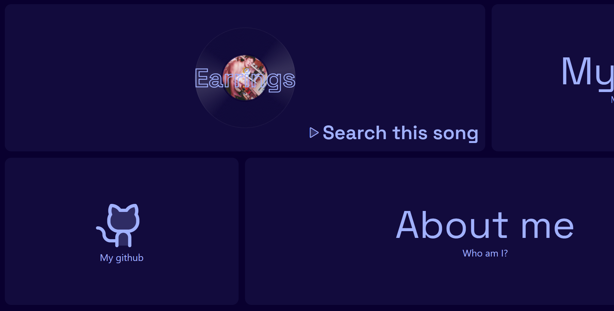
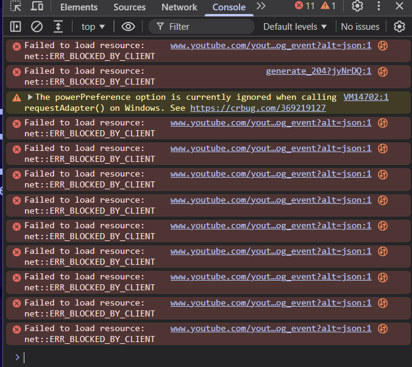

# cool update

Added now-playing:

Basically, I had one project [now-playing](https://proheartly.github.io/now-playing/), I added a small version of this to our site in the first section. This was quite fun trying and breaking. I also tried to play the music that I was playing in the site by youtube iframe but I ran into many errors and just gave up.

So now, it will just take you to search page of yt with that song as query. And if no song is playing, it will take you to [my last.fm profile](https://www.last.fm/user/heartlye)