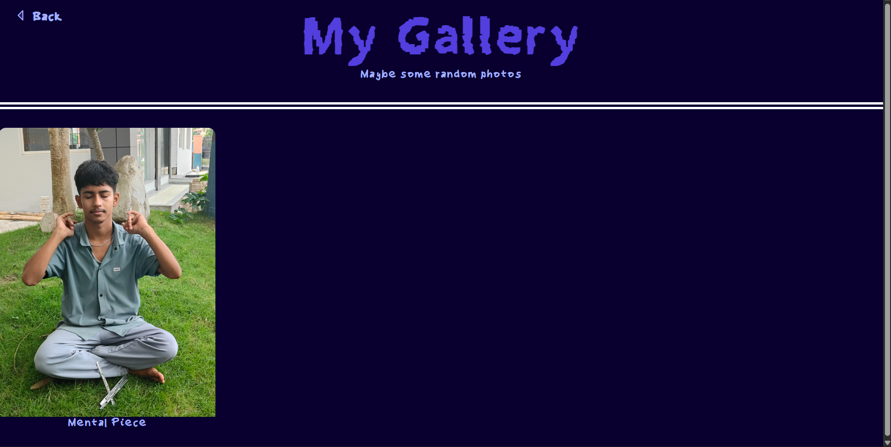

# Making gallery:

Btw I was at first trying to make about me but ran out of idea so for now this is what about me looks like


I will work on it when I get some idea for it!

Beside that, lets work on galleryy! I wana make smth like [this](https://proheartly.github.io/my-gallery/) with custom font and all :D

**forgot to mention!**
I hosted this in nest thingy, it took me a while, **A WHILE** to host it but finally its hosted in [this](https://site.heartly.hackclub.app)

**Made the gallery!**


Also! now it auto updates if I put any image inside `/content/gallery` but I do need to put captions in `/content/caption.json` with format `"<image_name>.<image_extension>": "<caption>"`. This was done using
```
def gallery(request: Request):
    images = []
    captions = {}
    captions = json.loads(caption_path.read_text(encoding="utf-8"))
    for f in sorted(gallery_path.iterdir()):
        images.append({
            "file": f.name,
            "caption": captions.get(f.name, f.stem),
        })

    return src.TemplateResponse(
        request=request,
        name="gallery.html",
        context={"request": request, "images": images},
    )
```
Here, it iterates thru the folder `/content/gallery` and adds that to `images` along with it caption from `captions` and sends it to the html by `context={"request": request, "images": images}`. Although `"request": request"` is not necessay, I was getting error prevoiusly so I placed it just in case.

This request gets picked up by `gallery.html`
and using:
```
<div class="photos">
    
    <div class="photo">
        
        <p>{{ img.caption }}</p>
    </div>
    
</div>
```
it creates the automatic gallery thingy :)