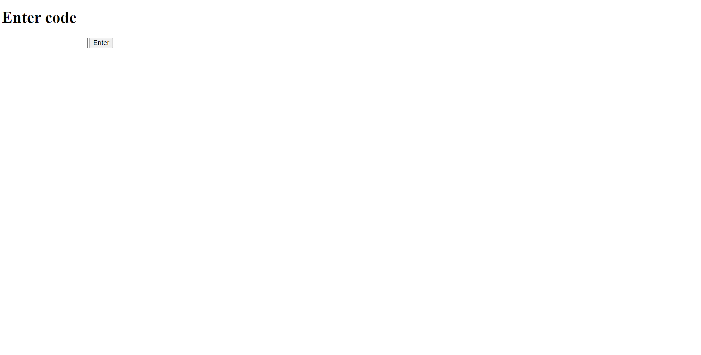

# Let's make a system to upload image to galleryyy

So what I'm thinking is a password system with 6 digit code and it allows to upload image along with captions

# Progress:
1) I made login system which works by using a static code saved in `.env` file. I didn't add any styling in the login page(im too lazy, dont mind me :D).

It also stores the session as cookie and it requests back using `request.session` and by using `max_age=None`, it expires as soon as we close our browser.

2) I made the upload section tooo


**Direction for recreation:**
* make a .env file with
    ```
        ADMIN_CODE=000000 # password here with 6 digit
        SESSION_SECRET=Xk3v9Qm_2LpZ8wRt # a long session text or jebrish
    ```